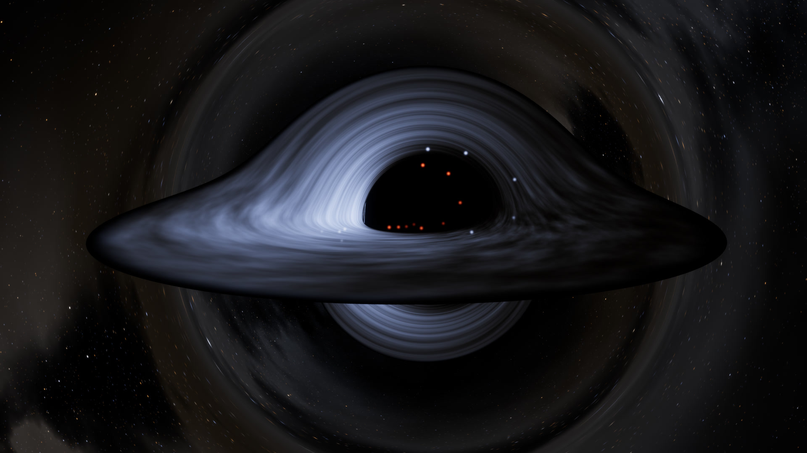

# Argia kerr zulo beltz baten inguruan

[In English: kerr.md](kerr.md)



`examples/kerr.rs`-ek argia errendatzen du zulo beltz txiki eta azkar biraka dabilen baten inguruan (a =
0.99 M biraketa), eta QOA erabiltzen du zulo horrek bere horizontean hutsetik sortzen dituen bikoteen
estatistika kuantikoak kalkulatzeko.

```sh
cargo run --release --example kerr -- --still kerr.png --out kerr.mp4
cargo run --release --example kerr -- --size 3840x2160 --fps 60 --out kerr-4k.mp4 -- -c:v libx265 -crf 16
cargo run --release --example kerr -- --help      # biraketa, inklinazioa, distantzia, ikus-eremua, diskoa, iraupena...
```

Bi zati ditu, eta fisika mota desberdinak dira.

## 1. Argia nora doan: erlatibitate orokorra (klasikoa)

Fotoiek kerr metrikaren geodesiko nuluak jarraitzen dituzte. Pixel bakoitzeko (lehenetsita bederatzi pixel
bakoitzeko, bakoitza pixelaren bederatziren baten barruko ausazko puntu finko batean) programak bat
trazatzen du kameratik atzera:

- **Ekuazioak.** H = ½ g^μν p_μ p_ν hamiltondarra boyer-lindquist koordenatuetan, bere deribatuak modu
  analitikoan idatzita, 64 biteko koma higikorrean cash-karp runge-kutta metodo moldakor batekin integratua.
  E energia eta L momentu angeluarra konstanteak dira; r, θ, p_r eta p_θ eboluzionatzen dute, baita t
  koordenatu-denbora ere, izpi bakoitzaren bidaia-denbora ematen duena.
- **Kamera.** Momentu angeluar zeroko behatzaile bat r = 40 M-n (`--distance`), 36 graduko ikus-eremu
  bertikalarekin (`--fov`). Markoaren arrastearekin batera biratzen da, beraz ez du bere biraketarik ikusten.
- **Amaierak.** Izpi bat diskoan, zuloan edo zeruan amaitzen da, 5000 M-ra, non geratzen zaion makurdura
  4e-4 radian ingurukoa den.

Izpiak behin trazatzen dira; gero irudi bakoitzak diskoa bere unean margotzen du. 1080p-ko irudi batek, 9
izpirekin pixel bakoitzeko, 3 minutu inguruko trazaketa behar du 4 nukleotan, eta gero 1,5 segundo inguru
irudi bakoitzeko.

### Irudiak zer erakusten duen

| zatia | nola kalkulatzen den | fisika ala aukera |
|---|---|---|
| itzala, fotoi-eraztuna, urruneko aldea goitik altxatuta, azpiko aldearen irudia | geodesikoak | fisika |
| diskoaren tenperatura | page-thorne disko mehea: fluxu erlatibista, barneko orbita egonkorrean momenturik gabe; gasa beroena r ≈ 2 M-n dago | fisika; gailurra (`--temperature`, 25.000 K) eszenaren aukera da |
| diskoaren kolorea eta distira | g·T-ko gorputz beltza, zehazki: I_ν/ν³ izpi batean kontserbatzen da, beraz gorputz beltz bat gorputz beltz geratzen da tenperatura desplazatuan. g-k doppler efektua eta gorriranzko desplazamendu grabitazionala batzen ditu. Espektroa CIE 1931 kolore-funtzioekin integratzen da sRGB-ra | fisika |
| zati bakoitza noiz ikusten den | izpi bakoitzak bere bidaia-denbora dakar, beraz diskoa argi hori irten zenean zegoen bezala marrazten da; bigarren irudia lehena baino zaharragoa da | fisika |
| izarrak | kokapenak eta distira lenteo-efektuarekin: pixel bakoitzaren aztarnak zeruan handitzea ematen du, beraz izar baten argia kontserbatzen da, distiratsuago lenteak handitzen duen tokian eta ahulago estutzen duen tokian | lenteo-efektua fisika da; izar-eremua eszena bat |
| galaxia | izar eta gas banda bat hauts-ildoekin, zuloaren atzean, lenteo-efektuz eraztunetan | eszena |
| diskoaren ehundura | distira-aldaketa log-normalak, orbitan dabilen gasak eramanak eta biraketa diferentzialak luzatuak | artistikoa |
| distira eta tonua | argi osoa gordetzen duen bi eskalako kamera-distira bat, ACES tonu-mapaketa, sRGB, dithering-a | kamera |

Fisika probatuta dago (`cargo test --release --example kerr`):

| egiaztapena | emaitza |
|---|---|
| biratzen ez den zuloa: fotoiak 3√3 M talka-parametroaren azpitik harrapatzen dira | bai, % 1-en barruan |
| eremu ahula: desbideratzea 4M/b + 15π/4 (M/b)² b = 300 M-n | % 1-en barruan |
| biraka dagoen zuloa (a = 0.9): ekuatoreko harrapatze-mugak b = 2.8444 M-n (biraketaren alde) eta 6.8323 M-n (aurka), potentzial erradialetik modu independentean kalkulatuak | 0.01 M-ren barruan |
| H = 0 eta carter-en konstantea konstante geratzen dira ekuatoretik kanpoko izpietan | 1e-6-raino |
| page-thorne fluxua datorren integral erlatibistaren aurka, 0, 0.5 eta 0.99 biraketekin | 1e-6-raino |
| izpi erradial baten bidaia-denbora schwarzschild-en Δr + 2M ln((r - 2M)/(r0 - 2M))-ren aurka | 1e-7-raino |
| izar baten argia estaltzen dituen pixel guztietan batuta | bere fluxua, 1e-3-raino |
| koloreak: 6500 K zuria, 3000 K gorria, 30.000 K urdina; distira T-rekin hazten da eta T-ren proportzionala bihurtzen da (rayleigh-jeans) | bai |

## 2. Energia sortzen eta desagertzen: hawking bikoteak (kuantikoa, QOA-rekin)

Horizontetik hurbil hutsak bikoteak sortzen ditu: kuanto batek ihes egiten du hawking erradiazio gisa, bere
bikotekidea erori egiten da energia negatiboa daramala, eta zuloak masa galtzen du. ω maiztasun eta m zenbaki
azimutal baterako, bikotea bi moduko huts estutu bat da, tanh² r = e^(-x), x = (ω - mΩ_H)/T_H.

QOA-k egoera hori bere agindu propioekin eraikitzen du, zulo beltzetarako ezer berezirik gabe:

```
QMODE 2 <muga>
SQUEEZE o0 r
SQUEEZE o1 r pi
BS o0 o1 pi/4          ; modu bakarreko bi estutzaile 50:50 izpi-zatitzaile batean = bi moduko estutzaile bat
```

eta programak QOA-k kalkulatzen duena fisikaren aurka egiaztatzen du:

```
hawking    tenperatura T = κ/2π = 0.00984 (1/M unitateetan). ...
                  ω   m       x          r     <n> QOA  <n> Planck   bikotegabe
             0.0098   0    1.00    0.70341    0.581977    0.581977      1.3e-13
             0.0148   0    1.50    0.51311    0.287217    0.287217      1.9e-14
             0.0197   0    2.00    0.38597    0.156518    0.156518      2.6e-15
             0.0295   0    3.00    0.22695    0.052396    0.052396      5.1e-17
             0.4436   1    1.00    0.70341    0.581977    0.581977      1.3e-13
             0.4535   1    2.00    0.38597    0.156518    0.156518      2.6e-15
proba      QOA-ren batez besteko fotoi-kopuruak planck-en 1/(e^x - 1)-ekin bat datoz 8.8e-12-raino ...
```

- Ihes egiten duen kuantoaren fotoi-kopurua termikoa da, 1/(e^x - 1) batez bestekoarekin: planck-en legea,
  hawking tenperaturako gorputz beltz baten espektroa, estutzetik eta izpi-zatitzaile batetik besterik gabe
  ateratzen da.
- Ihes egiten duten eta erortzen diren fotoi-kopuruak beti berdinak dira ("bikotegabe" desberdinak izateko
  probabilitatea da): ateratzen den kuanto bakoitzak sartu den bikotekide bat du.
- m = 1 moduek biraketa sentitzen dute mΩ_H potentzial kimikoaren bidez. 0 < ω < mΩ_H denean biraka dagoen
  zulo batek uhinak anplifikatzen ditu horren ordez eta biraketa-energia galtzen du (superradiantzia);
  erregimen hori ez dago hemen modelatuta.

Bideoan, irudi bakoitzeko bikote-kopurua QOA-k kalkulatutako banaketetatik lagintzen da. Non agertzen diren
(itzalaren ertzean) eta nola mugitzen diren (bat kanpora, bestea barrura) irudikapena da.

## Eskala, zintzotasunez

Diskoaren 25.000 K-eko gailur lehenetsiak bere koloreak ikusgai mantentzen ditu. Benetako diskoak beroagoak
dira: 10^5 K inguru zulo supermasibo baten inguruan eta 10^7 K (X izpiak) izar-zulo baten inguruan. 10^5 K
ingurutik gora gorputz beltz baten kolore ikusgaia ia ez da aldatzen (rayleigh-jeans-en isatsean dago),
beraz disko hori urdin-zuri bera ikusiko litzateke, distiratsuago bakarrik.

Hawking-en tenperatura 1.2e23 K da gutxi gorabehera zuloaren masarekin (kilogramotan) zatituta. Eguzkiaren
masako zulo bat 6e-8 K inguruan dago, mikrouhin-hondo kosmikoa baino askoz hotzago; oso zulo arin bat
bakarrik (1e11 kg, mendi baten masa) iristen da 1e12 K-ra. Bideoko distirak, beraz, asko handituta daude;
formak, gorriranzko desplazamenduak eta estatistikak ez.

Izen-kointzidentzia bat: QOA-ren `KERR` agindua kerr efektu optikoa da (John Kerr, 1875), kerr zulo
beltzarekin (Roy Kerr, 1963) zerikusirik gabea.
