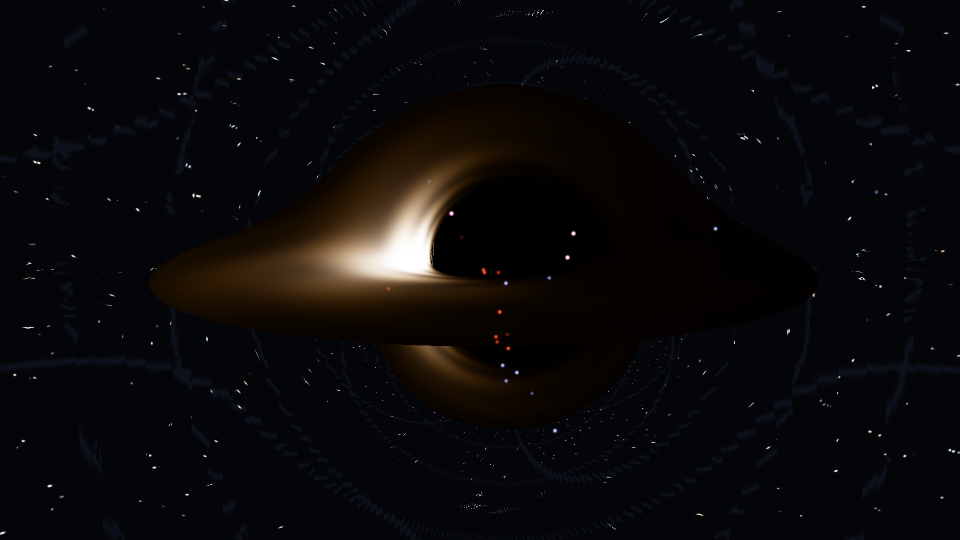

# Argia kerr zulo beltz baten inguruan

[In English: kerr.md](kerr.md)



`examples/kerr.rs`-ek argia errendatzen du zulo beltz txiki eta azkar biraka dabilen baten inguruan (a =
0.99 M biraketa), eta QOA erabiltzen du zulo horrek bere horizontean hutsetik sortzen dituen bikoteen
estatistika kuantikoak kalkulatzeko.

```sh
cargo run --release --example kerr -- --still kerr.png --out kerr.mp4
cargo run --release --example kerr -- --help      # biraketa, inklinazioa, tamaina, iraupena, hazia
```

Bi zati ditu, eta fisika mota desberdinak dira.

## 1. Argia nora doan: erlatibitate orokorra (klasikoa)

Fotoiek kerr metrikaren geodesiko nuluak jarraitzen dituzte. Pixel bakoitzeko (lehenetsita lau pixel
bakoitzeko) programak bat trazatzen du kameratik atzera:

- **Ekuazioak.** H = ½ g^μν p_μ p_ν hamiltondarra boyer-lindquist koordenatuetan, bere deribatuak modu
  analitikoan idatzita, cash-karp runge-kutta metodo moldakor batekin integratua. E energia eta L momentu
  angeluarra konstanteak dira; r, θ, p_r eta p_θ eboluzionatzen dute.
- **Kamera.** Momentu angeluar zeroko behatzaile bat r = 40 M-n (markoaren arrastearekin batera biratzen
  den behatzailea, beraz ez du bere biraketarik ikusten).
- **Diskoa.** Disko mehe bat barneko orbita zirkular egonkorretik (r = 1.45 M a = 0.99-rekin) 14 M-raino,
  bere gasa Ω = 1/(r^{3/2} + a) orbita zirkular keplertarretan. Kolorea g = 1/(u^t (E - Ω L)) maiztasun-
  erlaziotik dator, doppler efektua eta gorriranzko desplazamendu grabitazionala batzen dituena: kamerarantz
  mugitzen den aldea distiratsuagoa eta urdinagoa da (intentsitatea ∝ g⁴). Tenperatura-profila eta
  zurrunbiloak eredu artistiko bat dira.
- **Zerua.** Izarrak eta 15 graduko sare ahul bat, atzealdearen lenteo-efektua ikusteko.

Ekuazioetatik ateratzen dena, ez marrazketatik: itzala, bere forma zapaldua eta desplazatua (zuloaren
biraketak argia arrastatzen du alde batean), diskoaren urruneko aldearen irudia goitik altxatuta, eta bere
azpiko aldearen bigarren irudia behean.

Integratzailea probatuta dago (`cargo test --release --example kerr`):

| egiaztapena | emaitza |
|---|---|
| biratzen ez den zuloa: fotoiak 3√3 M talka-parametroaren azpitik harrapatzen dira | bai, % 1-en barruan |
| eremu ahula: desbideratzea 4M/b + 15π/4 (M/b)² b = 300 M-n | % 1-en barruan |
| biraka dagoen zuloa (a = 0.9): ekuatoreko harrapatze-mugak b = 2.8444 M-n (biraketaren alde) eta 6.8323 M-n (aurka), potentzial erradialetik modu independentean kalkulatuak | 0.01 M-ren barruan |
| H = 0 eta carter-en konstantea konstante geratzen dira ekuatoretik kanpoko izpietan | 1e-6-raino |

## 2. Energia sortzen eta desagertzen: hawking bikoteak (kuantikoa, QOA-rekin)

Horizontetik hurbil hutsak bikoteak sortzen ditu: kuanto batek ihes egiten du hawking erradiazio gisa, bere
bikotekidea erori egiten da energia negatiboa daramala, eta zuloak masa galtzen du. ω maiztasun eta m zenbaki
azimutal baterako, bikotea bi moduko huts estutu bat da, tanh² r = e^(-x), x = (ω - mΩ_H)/T_H.

QOA-k egoera hori bere agindu propioekin eraikitzen du, zulo beltzetarako ezer berezirik gabe:

```
QMODE 2 <muga>
SQUEEZE o0 r
SQUEEZE o1 r pi
BS o0 o1 pi/4          ; modu bakarreko bi estutzaile 50:50 izpi-zatitzaile batean = bi moduko estutzaile bat
```

eta programak QOA-k kalkulatzen duena fisikaren aurka egiaztatzen du:

```
hawking    tenperatura T = κ/2π = 0.00984 (1/M unitateetan). ...
                  ω   m       x          r     <n> QOA  <n> Planck   bikotegabe
             0.0098   0    1.00    0.70341    0.581977    0.581977      1.3e-13
             0.0148   0    1.50    0.51311    0.287217    0.287217      1.9e-14
             0.0197   0    2.00    0.38597    0.156518    0.156518      2.6e-15
             0.0295   0    3.00    0.22695    0.052396    0.052396      5.1e-17
             0.4436   1    1.00    0.70341    0.581977    0.581977      1.3e-13
             0.4535   1    2.00    0.38597    0.156518    0.156518      2.6e-15
proba      QOA-ren batez besteko fotoi-kopuruak planck-en 1/(e^x - 1)-ekin bat datoz 8.8e-12-raino ...
```

- Ihes egiten duen kuantoaren fotoi-kopurua termikoa da, 1/(e^x - 1) batez bestekoarekin: planck-en legea,
  hawking tenperaturako gorputz beltz baten espektroa, estutzetik eta izpi-zatitzaile batetik besterik gabe
  ateratzen da.
- Ihes egiten duten eta erortzen diren fotoi-kopuruak beti berdinak dira ("bikotegabe" desberdinak izateko
  probabilitatea da): ateratzen den kuanto bakoitzak sartu den bikotekide bat du.
- m = 1 moduek biraketa sentitzen dute mΩ_H potentzial kimikoaren bidez. 0 < ω < mΩ_H denean biraka dagoen
  zulo batek uhinak anplifikatzen ditu horren ordez eta biraketa-energia galtzen du (superradiantzia);
  erregimen hori ez dago hemen modelatuta.

Bideoan, irudi bakoitzeko bikote-kopurua QOA-k kalkulatutako banaketetatik lagintzen da. Non agertzen diren
(itzalaren ertzean) eta nola mugitzen diren (bat kanpora, bestea barrura) irudikapena da.

## Eskala, zintzotasunez

Hawking-en tenperatura 1.2e23 K da gutxi gorabehera zuloaren masarekin (kilogramotan) zatituta. Eguzkiaren
masako zulo bat 6e-8 K inguruan dago, mikrouhin-hondo kosmikoa baino askoz hotzago; oso zulo arin bat
bakarrik (1e11 kg, mendi baten masa) iristen da 1e12 K-ra. Bideoko distirak, beraz, asko handituta daude;
formak, gorriranzko desplazamenduak eta estatistikak ez.

Izen-kointzidentzia bat: QOA-ren `KERR` agindua kerr efektu optikoa da (John Kerr, 1875), kerr zulo
beltzarekin (Roy Kerr, 1963) zerikusirik gabea.
