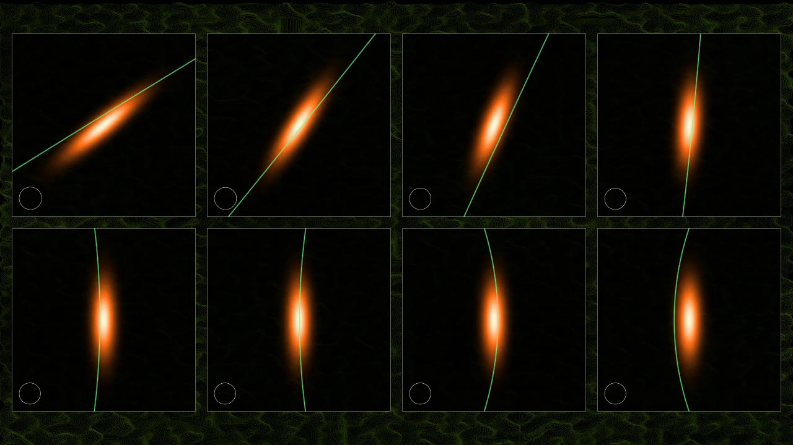

# Music through light: `qoa visual`

*[Euskaraz](visual.eu.md)*

`qoa visual` sends audio through a simulated quantum optical circuit and writes the result as audio, video
or both. The light is computed exactly. The video is art that follows the processed sound.

```
qoa visual song.mp3 out.mp4                          # video with the processed audio
qoa visual song.flac out.flac --audio-only           # processed audio only
qoa visual song.mp3 out.mp4 --keep-audio             # original audio, video from the processed light
qoa visual song.mp3 out.mp4 --video-only             # video, no audio track
ffmpeg -i song.mp3 -f s16le -ac 1 -ar 48000 - | qoa visual - out.wav --raw s16le --rate 48000 --channels 1 --audio-only
qoa visual song.flac out.mkv --resolution 3840x2160 --fps 60 --phase-space full -- -c:v libx265 -crf 14
```

The input is anything ffmpeg can read (mp3, flac, wav, ogg, the audio of a video...), or raw samples from a
file or from standard input (`-`) with `--raw FORMAT --rate HZ --channels N`. The output's extension picks
the container. Defaults: 24-bit for `.wav` and `.flac`, FLAC inside `.mkv`, AAC at 320 kb/s inside `.mp4`.
Anything after `--` goes to ffmpeg as it is.

## What happens to the sound

1. **Decoding.** ffmpeg decodes the input to 64-bit floating point, every channel kept.
2. **Modes.** Each channel is split into optical modes with an orthonormal lapped transform: an MDCT with a
   sine window and 50% overlap, `--block` modes per block (default 1024). Every sample is one mode, and
   because the modes are orthonormal, the light's photon number is the sound's energy.
3. **Light.** Each mode carries a coherent state |α⟩. A full-scale tone has `--photons` photons per sample
   (default 100,000). The music rides on the X quadrature, with the local oscillator as the phase reference.
4. **Circuit**, in this order:
   - `--mix RAD`: a mesh of beamsplitters between neighbouring bands;
   - `--loss L`: a fraction L of the light is lost. A classical gain after detection restores the loudness,
     so loss is heard as a worse signal-to-noise ratio;
   - `--squeeze DB`: the source is squeezed in X, so the measured quadrature is quieter than shot noise, as
     in gravitational-wave detectors;
   - `--kerr RAD`: Kerr self-phase modulation, U = exp(−iκ n(n−1)). The brightest mode picks up RAD
     radians, quieter modes less: an amplitude-dependent phase that bends the sound. Its mean field
     collapses as the phase spreads.
5. **Detection** (`--detect`):
   - `homodyne` (default): one measurement of X per mode, with the real vacuum noise. Fewer photons give
     more hiss. The noise power per sample is exactly 1/(8·photons) of full scale, before squeezing and
     loss.
   - `mean`: the exact expectation value ⟨x⟩, as if averaged over infinitely many shots. With no effects
     the sound comes back unchanged to within 1e-12.
   - `count`: photon counting, one shot per mode, with exact Poisson statistics. Counting cannot see the
     sign, which is taken from the mean field.
6. **Back to sound** with the inverse transform.

## How exact it is

Nothing in the light is approximated:

- Rotations and loss turn coherent states into coherent states.
- The squeezed homodyne noise is Gaussian in closed form.
- The Kerr mean field is α·exp(|α|²(e^(−2iκ) − 1)). `tests/light.rs` checks it against a direct sum in the
  photon-number basis, to 1e-12.
- Kerr leaves the photon statistics Poisson, and they are sampled exactly, for any mean up to billions,
  with Hörmann's transformed rejection and an exact log-probability.
- After a Kerr medium, a homodyne shot is drawn from the exact distribution of the non-Gaussian state:
  - The Kerr phase κn(n−1) is split exactly into a rotation of the coherent state and a quadratic chirp
    over the photon numbers that matter.
  - The chirp's Fourier coefficients turn the state into a superposition of rotated coherent states. One
    FFT per window size is shared by every mode, and coefficients are dropped only while their total stays
    below 1e-12.
  - That superposition is moved into a frame displaced to the state's classical point, where it is a short
    photon-number expansion. The expansion stops when its coefficients fall below 1e-17 in amplitude.
  - The shot comes from inverting the exact cumulative distribution. Its off-diagonal terms are a
    Wronskian of Hermite functions, and its diagonal terms come from a ladder-operator recurrence.
  - `tests/light.rs` checks the density against a direct sum in the photon-number basis to 1e-12 (it agrees
    to about 1e-14), and the samples' mean and variance against their closed forms.
  - A shot costs about 0.15 ms on one core when the mode's Kerr phase is small (most modes), and 1.5 to
    2.5 ms when it is large (the brightest modes with `--kerr 2`). Modes run in parallel on every core.
- The noise comes from a seeded generator per channel and block, so the same seed gives the same output on
  any number of threads.

Squeezed light is exact in every combination:

- **Loss.** Squeezed light that has gone through loss is a mixed Gaussian state. It is written exactly as a
  pure squeezed state displaced by classical Gaussian noise in the P quadrature, so each shot draws that
  noise and then works with a pure state.
- **Counting.** The photon numbers of a displaced squeezed state come from the FFT of its characteristic
  function ⟨e^{iφn̂}⟩, which has a closed form (a Gaussian integral). They are checked against Poisson to
  1e-14 and against a direct photon-number recurrence to 1e-13.
- **Through a Kerr medium.** The same expansion is used with rotated squeezed coherent states, whose
  amplitudes follow a three-term recurrence kept on a separate scale so nothing underflows. The density
  agrees with a direct photon-number-basis sum to 1e-12.
- **Mean field.** ⟨e^{iφn̂}a⟩ has a closed form for a squeezed coherent state, and averaging it over the
  loss noise is a closed-form Gaussian integral. It agrees with direct computation to 1e-12.
- **With `--detect mean` and no Kerr,** squeezing has no effect: it changes only the noise, which the mean
  removes. The report says so.

## The video

The video has two layers. Any resolution and frame rate work (`--resolution 3840x2160 --fps 60` for 4K60),
and anything after `--` goes to ffmpeg, so the encoder, quality and container are yours to pick.

**The art.** Each frame takes the processed sound's loudness, spectral centroid, band energies and
transients, and drives a noise field, an interference pattern, flicker and a spectrum bar. It follows the
light's output, so quantum noise and Kerr distortion show up in the picture.

**The light's quantum states** (`--phase-space`). Each frame shows the brightest modes at that moment, as
they are just before detection. Each one is drawn as its Wigner function, the quantum version of a
probability map over the two quadratures X (horizontal) and P (vertical):



- **Colours.** Orange to white is where the state lives. Blue marks negative values, which no classical
  state can have; they appear when the Kerr medium is strong enough.
- **The small ring** in the corner is the size of the vacuum's noise, for scale. A coherent state is a round
  blob that size, squeezed light is an ellipse, and Kerr light shears into a crescent.
- **The green mark** is what was measured: a vertical line at the homodyne result, a dashed line at the
  exact mean, or an arc at the photon number that was counted. An arc is part of the circle of radius
  √(2n+1) around the origin.
- **Layout.** `row` (default) puts 4 panels over the art, `full` gives the frame to 8 large panels, and
  `off` turns them off.

The panels are computed, not sketched:

- With no Kerr medium the state is Gaussian and drawn in closed form.
- With Kerr it comes from the same exact expansion the homodyne shots use.
- Squeezing, loss and Kerr together make a mixed state. It is averaged over the loss noise with a rule
  that refines itself until the picture stops changing (to 1e-3 of its peak), using up to 705 pure states.
- Each pixel is the average of W over that pixel, so details finer than a pixel cannot alias into false
  patterns. `tests/light.rs` checks this against direct integration to 1e-5. It also checks that every
  panel holds probability 1 and the state's exact mean field.

With no Kerr medium the panels cost almost nothing. With Kerr, and most with squeezing, loss and Kerr
together, they are the slowest part of the video: on 4 cores a 720p frame then takes 0.4 to 0.7 s.

Frames are drawn in parallel in a fixed order, so the same seed gives the same video.

## Real hardware

The circuit is what a continuous-variable photonic processor does: coherent and squeezed light, beamsplitter
meshes, Kerr media and homodyne or photon-number detection. No public cloud device takes audio-rate coherent
states today, so `qoa visual` simulates one.
